# Exploración de la planificación de procesos en XV6 y propuesta de incorporación de MLFQ

**Integrantes:**
* Benjamin Lopera Ochoa — `202515144`
* Sebastian Martinez Cabrera — `202519817`

---

## Paso 0: ¿Cómo funciona el MLFQ?

**MLFQ (Multi-Level Feedback Queue)** es un planificador que organiza los procesos listos en múltiples colas de distinta prioridad y aprende de su comportamiento pasado para minimizar tanto el tiempo de respuesta (en procesos interactivos) como el tiempo de retorno, sin conocer de antemano cuánto durará cada proceso.

### Parámetros configurables vs. datos desconocidos
* **Lo que define el planificador:** El número de colas (por ejemplo, `Q2`, `Q1` y `Q0`), el *quantum* (turno máximo en *Round-Robin*), el *allotment* (presupuesto total de CPU por nivel) y el periodo $S$ (*priority boost*).
* **Lo que no conoce el sistema operativo:** El `BurstTime` (duración total del proceso) y los tiempos futuros de llegada (`ArrivalTime`), los cuales solo se fijan al diseñar escenarios de prueba o simulaciones. El sistema operativo únicamente rastrea en qué cola está cada proceso y cuánto *allotment* lleva gastado.

### Reglas y condiciones de funcionamiento
1. **Prioridad entre colas (Regla 1):** Siempre se ejecuta un proceso de la cola más alta que tenga procesos listos.
2. **Empate en una cola (Regla 2):** Si hay varios procesos en el mismo nivel, alternan turnos en *Round-Robin* según el *quantum* de esa cola.
3. **Ingreso (Regla 3):** Todo proceso nuevo entra en la cola de mayor prioridad (`Q2`) asumiéndose inicialmente como corto o interactivo.
4. **Condición para mantenerse o bajar (Regla 4):** Mientras un proceso no agote su *allotment* acumulado en su nivel actual (por ejemplo, porque cede rápido la CPU para hacer E/S), permanece en esa cola; apenas consume por completo su *allotment* (de golpe o sumando ráfagas cortas), baja un nivel.
5. **Reinicio periódico cada periodo $S$ (Regla 5):** Al cumplirse el tiempo $S$, todos los procesos suben a la cola superior (`Q2`) con su *allotment* renovado y vuelven a competir en *Round-Robin*, evitando la inanición de procesos largos y adaptándose a cambios de fase.

---

## Paso 1: Preparación del repositorio (Fork) y entorno Linux

Se creó un *fork* del repositorio oficial `mit-pdos/xv6-riscv` en GitHub ([https://github.com/benjaminlopera-afk/xv6-riscv](https://github.com/benjaminlopera-afk/xv6-riscv)) y se clonó localmente dentro del directorio `~/xv6-riscv` de la máquina virtual Linux. Los datos base del entorno de trabajo y del repositorio son los siguientes:

* **Sistema operativo anfitrión (`uname -a`):** `Linux ubuntu-jammy 5.15.0-191-generic #201-Ubuntu SMP Fri Aug 7 18:39:04 UTC 2026 x86_64 GNU/Linux`.
* **Identificador (*hash*) del commit inicial (`git rev-parse HEAD~1`):** `fa2ddcb7ca87a77af579380a6eafd5aff163b44f`.

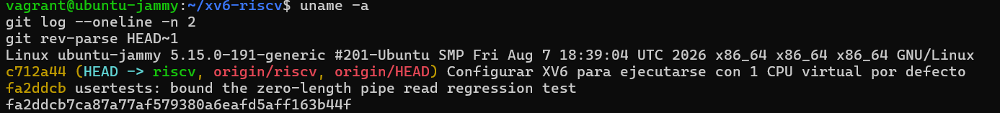

Asimismo, se verificó e instaló la cadena de herramientas de compilación cruzada para RISC-V y emulación requerida por XV6, confirmando las siguientes versiones instaladas en el sistema:

* **Compilador cruzado (`riscv64-linux-gnu-gcc`):** versión `11.4.0 (Ubuntu 11.4.0-1ubuntu1~22.04)`.
* **Emulador (`qemu-system-riscv64`):** versión `8.2.0`.
* **Herramienta de construcción (`make`):** `GNU Make 4.3`.
* **Control de versiones (`git`):** versión `2.34.1`.

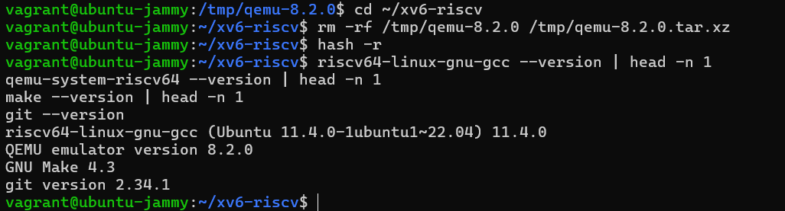

---

## Paso 2: Compilación y ejecución de XV6 con 1 CPU virtual

### 2.1 Compilación inicial y verificación funcional en QEMU
Se compiló el kernel y los programas de usuario de XV6 ejecutando `make qemu` desde la raíz del repositorio. En su configuración predeterminada, el sistema arranca con 3 núcleos virtuales (`hart 0`, `hart 1` y `hart 2`) hasta lanzar el shell inicial (`init: starting sh`). Dentro del entorno de XV6 se ejecutó el comando `ls`, listando correctamente los archivos y utilidades del sistema de archivos raíz (`README`, `cat`, `sh`, `usertests`, `console`, entre otros) y comprobando el funcionamiento operativo del sistema.

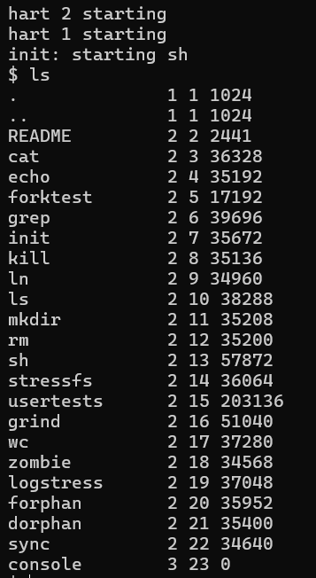

### 2.2 Configuración para una sola CPU virtual (`CPUS = 1`)
Al inspeccionar el archivo `Makefile` (líneas 174–178), se identificó que la variable `CPUS` toma por defecto el valor `3` y se pasa directamente al emulador mediante el parámetro `-smp $(CPUS)` en `QEMUOPTS`.

Para restringir la emulación a 1 sola CPU virtual sin modificar los recursos de hardware asignados a la máquina virtual Ubuntu anfitriona, se ejecutó inicialmente `make CPUS=1 qemu`. En la salida se comprobó que `qemu-system-riscv64` recibe la bandera `-smp 1` y que el arranque pasa directamente de `xv6 kernel is booting` a `init: starting sh`, omitiendo la inicialización de núcleos adicionales (`hart 1` y `hart 2`).

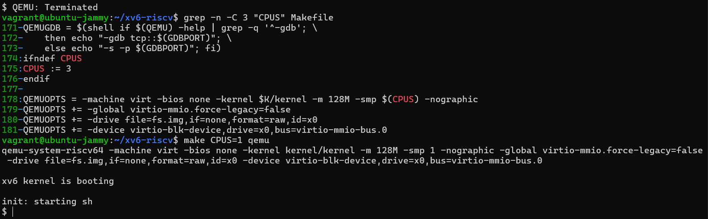

Finalmente, se dejó establecido `CPUS := 1` de forma permanente en el `Makefile` y se registró el cambio en el historial del repositorio mediante el commit `c712a44` en la rama `riscv`.

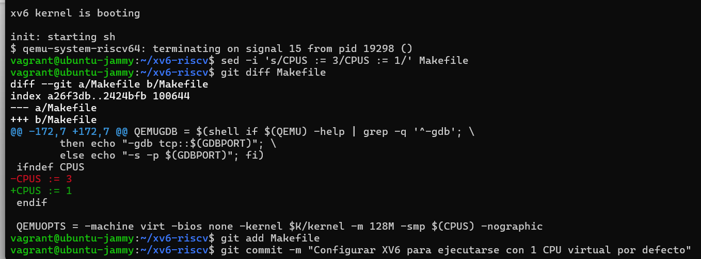

---

## Paso 3: Inspección del planificador original de XV6

### 3.1 Política de planificación por defecto y evidencia práctica
Por defecto, XV6 utiliza una política de planificación *Round-Robin* simple (sin niveles de prioridad), en la que todos los procesos comparten turnos iguales de `1` *tick*. El sistema operativo recorre la lista de procesos en orden circular y le da un turno corto de CPU a cada uno que esté listo para ejecutarse.

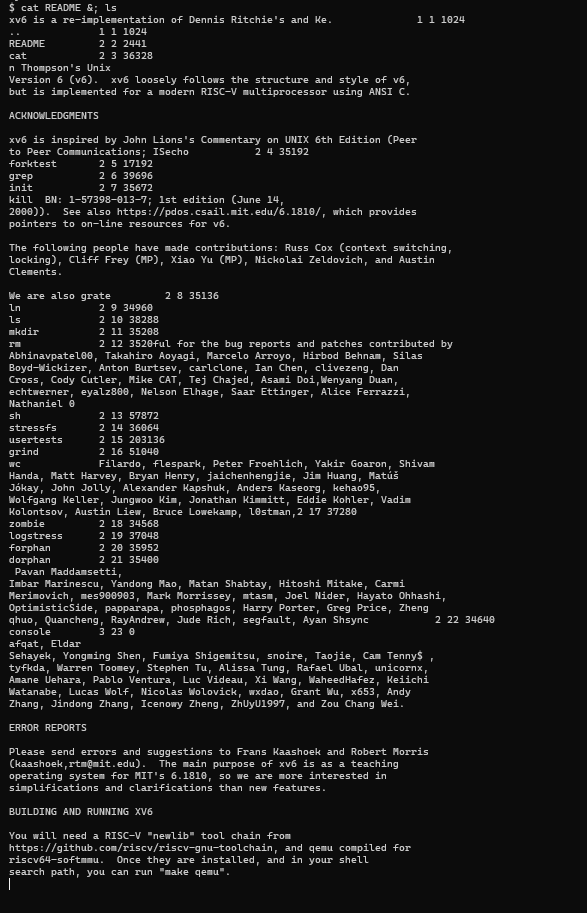

Al ejecutar simultáneamente `cat README &; ls` sobre una única CPU virtual (`-smp 1`), la consola muestra el texto del archivo `README` intercalado con el listado de archivos de `ls`. Este entrelazado confirma que ningún proceso monopoliza el procesador hasta finalizar; en su lugar, el planificador aplica *Round-Robin* alternando turnos cortos de `1` *tick* entre ambos procesos mientras permanecen en estado `RUNNABLE`.

### 3.2 ¿En qué archivo y función se implementa la operación del algoritmo de planificación donde se hace la selección del siguiente proceso a entrar a la CPU?
La selección del siguiente proceso que entra a ejecutarse en la CPU se realiza en la función `scheduler(void)` dentro de `kernel/proc.c` (líneas 429–470).

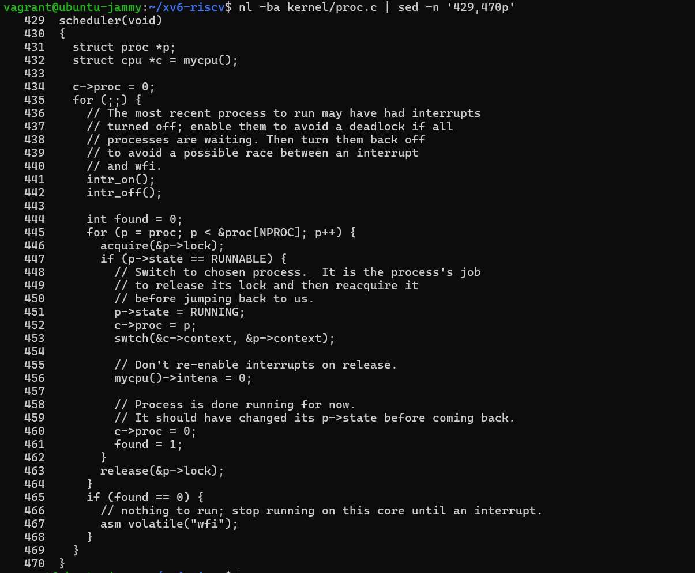

### 3.3 ¿Cómo se relaciona esa selección del proceso con los estados de los procesos y con los eventos que permiten ceder o recuperar la CPU?

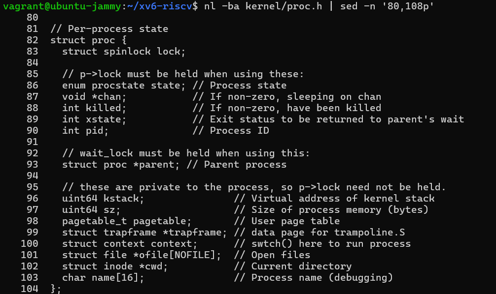

Para elegir quién usa la CPU, XV6 se guía por el campo `state` de cada proceso definido en `struct proc` (`kernel/proc.h`). El planificador solo toma en cuenta a los procesos que están listos (`RUNNABLE`), y el relevo entre el proceso que sale y el que entra ocurre mediante tres transiciones principales:

1. **Entrada a la CPU (`RUNNABLE` $\rightarrow$ `RUNNING`):** En `scheduler()` (`kernel/proc.c`, líneas 447–453), el sistema toma un proceso que estaba en `RUNNABLE`, lo cambia a `RUNNING` y le entrega el control del procesador haciendo el cambio de contexto con `swtch(&c->context, &p->context)`.
2. **Cesión por reloj (`RUNNING` $\rightarrow$ `RUNNABLE`):** Cuando se cumple un *tick* del temporizador (`which_dev == 2` en `usertrap()` y `kerneltrap()`, `kernel/trap.c`, líneas 85–86 y 157–158), el kernel llama a `yield()` (`kernel/proc.c`, líneas 501–508), que devuelve el proceso actual de `RUNNING` a `RUNNABLE` y ejecuta `sched()` para que otro proceso tome su turno.
3. **Espera de eventos y despertar (`RUNNING` $\rightarrow$ `SLEEPING` $\rightarrow$ `RUNNABLE`):** Si el proceso que está corriendo necesita esperar algo (como entrada/salida de teclado o disco), llama a `sleep()` (`kernel/proc.c`, líneas 562–572) para pasar a `SLEEPING` y soltar la CPU; cuando el evento ocurre, `wakeup()` (líneas 576–594) lo regresa a `RUNNABLE` para que `scheduler()` vuelva a considerarlo.

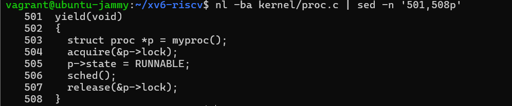

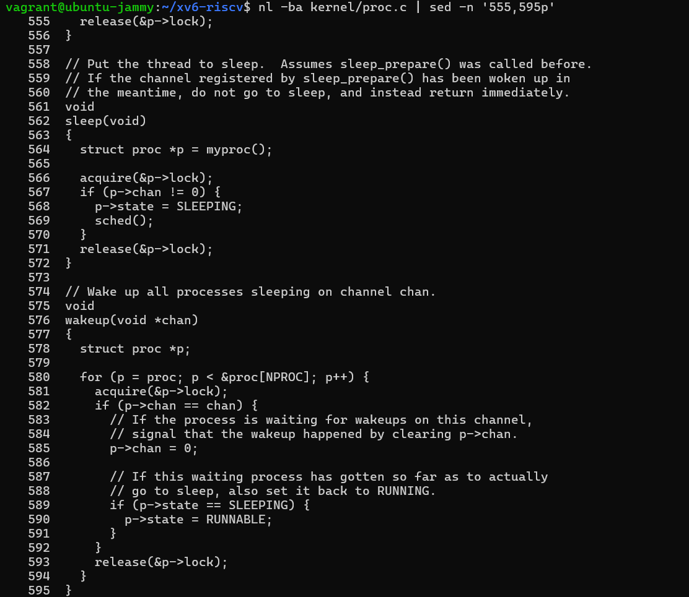

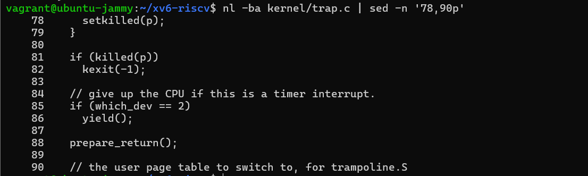

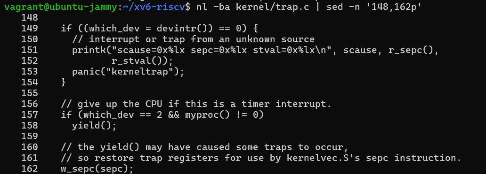

### 3.4 ¿Cómo se incorpora este código del algoritmo de planificación a la versión final del sistema operativo durante el proceso de compilación y construcción de XV6?
El código del planificador se integra al sistema operativo mediante el archivo `Makefile` ubicado en la raíz del proyecto, siguiendo tres pasos durante la construcción:

1. **Registro como módulo del kernel (`OBJS`):** En la variable `OBJS` (`Makefile`, líneas 4–28), se enlistan todos los archivos objeto (`.o`) que forman el núcleo. Allí aparecen `$K/proc.o` (donde están `scheduler()` y `yield()`), `$K/swtch.o` (cambio de contexto) y `$K/trap.o` (interrupciones de reloj), siendo `K=kernel`.
2. **Compilación cruzada a código objeto:** Al ejecutar `make` o `make qemu`, el compilador cruzado (`riscv64-linux-gnu-gcc`) traduce `kernel/proc.c` y el resto de archivos fuente a código máquina RISC-V generando cada `.o`.
3. **Enlazado del binario final (`$K/kernel`):** Finalmente, la regla `$K/kernel: $(OBJS) $K/kernel.ld` (`Makefile`, líneas 94–97) utiliza el enlazador `$(LD)` junto con el guion de memoria `kernel/kernel.ld` para unir todos esos objetos en el ejecutable `kernel/kernel`, que es el archivo que QEMU carga al iniciar mediante `-kernel $K/kernel` (`Makefile`, línea 178).

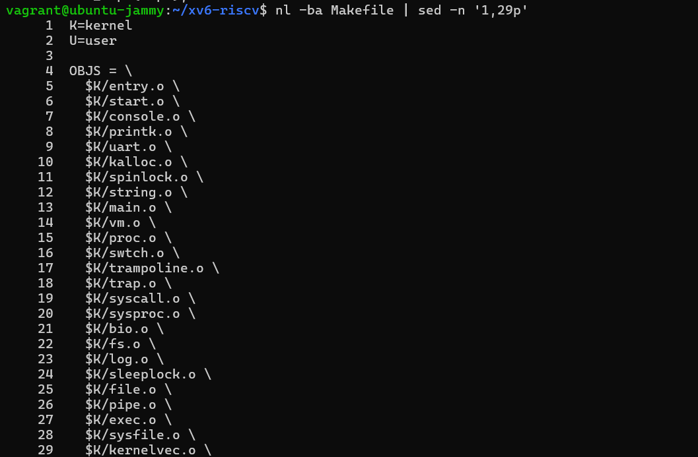

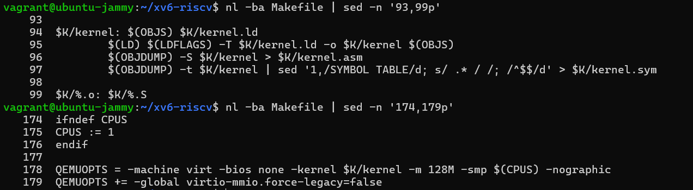

---

## Paso 4: Describir MLFQ y explorar su incorporación

### Prompt inicial utilizado con la IA (tutor socrático)

```text
Actúa como tutor socrático de una pareja de estudiantes de cuarto semestre de Ingeniería de Sistemas. Conocemos C++ y hemos comenzado a explorar XV6 para RISC-V.

Queremos identificar y justificar qué se necesitaría para incorporar MLFQ a XV6. En esta entrega no vamos a implementarlo.

Nuestra descripción inicial del algoritmo, escrita antes de esta conversación:
MLFQ (Multi-Level Feedback Queue) organiza los procesos listos en varias colas de distinta prioridad (Q2, Q1 y Q0) y aprende de su comportamiento pasado para reducir el tiempo de respuesta en tareas interactivas y el tiempo de retorno general, sin conocer de antemano el BurstTime ni los tiempos futuros de llegada. Define como parámetros el número de colas, el quantum por cola, el allotment por nivel y el periodo S (priority boost). Se rige por 5 reglas: (1) prioridad entre colas (si Prioridad(A) > Prioridad(B), corre A); (2) empate en una cola mediante Round-Robin con el quantum de ese nivel; (3) todo proceso nuevo entra en la cola superior Q2; (4) descenso de un nivel al agotar el allotment acumulado en la cola actual, sin importar cuántas veces haya cedido la CPU por E/S; y (5) reinicio periódico cada periodo S subiendo todos los procesos a Q2.

Dudas identificadas: (a) qué valores concretos de quantum y allotment asignar y qué ocurre con el allotment al llegar a Q0; (b) cómo contabilizar el tiempo si un proceso cede la CPU voluntariamente (sleep()) antes de agotar su quantum; y (c) en qué lugar del kernel ejecutar el priority boost cada S ticks sin conflictos de candados (p->lock).

Lo que averiguamos del planificador original y de su incorporación al sistema compilado:
XV6 usa por defecto un Round-Robin plano de 1 tick implementado en scheduler() (kernel/proc.c, líneas 429-470), recorriendo el arreglo estático proc[NPROC] para elegir el primer proceso en estado RUNNABLE, cambiarlo a RUNNING y cederle la CPU mediante swtch(&c->context, &p->context). Cuando ocurre una interrupción de temporizador (which_dev == 2 en usertrap() y kerneltrap(), kernel/trap.c, líneas 85-86 y 157-158), se invoca yield() (kernel/proc.c, líneas 501-508) para devolver el proceso a RUNNABLE; si espera E/S, llama a sleep() (SLEEPING) hasta que wakeup() lo devuelve a RUNNABLE. Durante la compilación, el Makefile enlista $K/proc.o, $K/swtch.o y $K/trap.o dentro de OBJS y los enlaza con kernel/kernel.ld para generar el binario kernel/kernel.

Reglas de interacción:
1. Formula una sola pregunta principal por turno y espera nuestra respuesta. No presentes una lista completa de cambios ni una arquitectura resuelta.
2. Empieza examinando nuestra descripción de MLFQ. Ayúdanos a detectar reglas ambiguas, ausentes o contradictorias. No sustituyas nuestra descripción por una versión terminada ni elijas silenciosamente una variante del algoritmo.
3. Pídenos que propongamos y justifiquemos las decisiones que faltan. Después, ayúdanos a comprobarlas con ejemplos pequeños de procesos y decisiones de planificación que nosotros debamos resolver.
4. Guíanos para relacionar cada regla con XV6. Antes de sugerir una modificación, pregúntanos qué comportamiento necesitamos y qué evidencia del código respalda nuestra propuesta.
5. No supongas que tienes acceso a nuestro repositorio. Pide los fragmentos necesarios y distingue lo observado de lo que todavía sea una hipótesis. No inventes archivos, funciones o comportamientos de nuestra versión.
6. No entregues código de implementación, parches, una lista cerrada de archivos por modificar ni pseudocódigo que resuelva el planificador. Revisa nuestras propuestas y señala problemas mediante preguntas y pistas graduales. Puedes explicar conceptos previos con ejemplos mínimos.
7. Si nos bloqueamos, reduce la dificultad de la pregunta y ofrece una pista concreta. Si pedimos la solución directa, conserva el modo socrático.

El objetivo es que nosotros logremos:
A. Redactar una descripción revisada y coherente de la variante de MLFQ considerada.
B. Explicar qué cambios necesitaría XV6 para soportarla, indicando para cada uno su propósito, su relación con las reglas y la evidencia del código que lo justifica.
C. Proponer escenarios para comprobar una futura implementación del algoritmo MLFQ en el sistema operativo XV6. Pídenos que expliquemos qué procesos participarían, qué harían, qué regla comprobaríamos y qué comportamiento esperaríamos observar. No nos entregues los escenarios resueltos. En esta tarea solo los describiremos; no vamos a programarlos ni ejecutarlos.

Mantén el análisis dentro del alcance de una propuesta: no necesitamos implementar MLFQ ni construir un selector de planificadores. Ayúdanos a registrar las cuestiones que queden pendientes de investigación.

Al finalizar, pídenos que redactemos nuestras conclusiones. Comprueba su consistencia mediante una última pregunta aplicada a un caso concreto, sin escribir por nosotros el reporte.

Comienza con una pregunta que permita comprobar cómo entendemos una regla de nuestra descripción inicial de MLFQ.
```

---

### 4.1 Descripción inicial de MLFQ y dudas pendientes
MLFQ (*Multi-Level Feedback Queue*) es un planificador que organiza los procesos listos en varias colas de distinta prioridad y aprende de su comportamiento pasado para reducir el tiempo de respuesta en tareas interactivas y el tiempo de retorno general, sin conocer de antemano cuánto durará cada proceso.

* **Parámetros configurables vs. datos desconocidos:** El planificador define el número de colas (`Q2`, `Q1` y `Q0`), el *quantum* (turno máximo continuo en *Round-Robin* por cola), el *allotment* (presupuesto total de CPU permitido en un mismo nivel) y el periodo $S$ (*priority boost*). En cambio, el sistema desconoce el `BurstTime` (duración total) y los tiempos futuros de llegada; solo rastrea en qué cola está cada proceso y cuánto *allotment* lleva gastado.
* **Regla 1 (Prioridad entre colas):** Si $\text{Prioridad}(A) > \text{Prioridad}(B)$, se ejecuta $A$ y $B$ espera.
* **Regla 2 (Empate en una cola):** Si $\text{Prioridad}(A) = \text{Prioridad}(B)$, ambos alternan turnos en *Round-Robin* según el *quantum* de esa cola.
* **Regla 3 (Ingreso):** Todo proceso nuevo entra en la cola de mayor prioridad (`Q2`), asumiéndose inicialmente como corto o interactivo.
* **Regla 4 (Descenso por *allotment*):** Mientras un proceso no agote su *allotment* acumulado en su nivel actual (por ejemplo, porque cede rápido la CPU para hacer E/S), permanece en esa cola; apenas consume todo su *allotment* (de golpe o sumando ráfagas cortas), baja un nivel.
* **Regla 5 (Reinicio periódico cada periodo $S$):** Al cumplirse el tiempo $S$, todos los procesos suben a la cola superior (`Q2`) con su *allotment* renovado para evitar la inanición.

**Dudas pendientes identificadas antes de la sesión con el tutor:**
1. ¿Qué valores concretos de *quantum* y *allotment* convienen para cada cola y qué pasa con el presupuesto de tiempo cuando un proceso ya bajó hasta la cola de menor prioridad (`Q0`)?
2. Si un proceso cede la CPU voluntariamente por entrada/salida (`sleep()`) antes de completar su *quantum*, ¿cómo debe contabilizarse ese tiempo para evitar que burle la Regla 4?
3. ¿En qué lugar exacto del kernel conviene verificar y ejecutar el reinicio periódico cada $S$ *ticks* para no generar problemas de sincronización con los candados (`p->lock`)?

---

### 4.2 Descripción revisada y coherente de MLFQ
Tras analizar las ambigüedades iniciales, definimos los parámetros exactos y separamos el concepto de *quantum* (duración máxima de un turno continuo antes de ceder el paso en *Round-Robin*) del *allotment* (presupuesto total acumulativo de *ticks* en un mismo nivel antes de descender).

#### Parámetros concretos de la variante propuesta
* **Número de colas:** 3 niveles de prioridad: `Q2` (alta), `Q1` (media) y `Q0` (baja).
* **`Q2` (Prioridad alta):** *Quantum* = `1` *tick*, *Allotment* = `4` *ticks*. Da respuesta inmediata a procesos nuevos o interactivos.
* **`Q1` (Prioridad media):** *Quantum* = `2` *ticks*, *Allotment* = `8` *ticks*. Atiende procesos mixtos con turnos un poco más largos.
* **`Q0` (Prioridad baja):** *Quantum* = `4` *ticks*, *Allotment* = $\infty$ (sin descenso adicional). Al no existir una cola inferior, los procesos pesados rotan en *Round-Robin* cada `4` *ticks* para reducir cambios de contexto hasta el siguiente *priority boost*.
* **Periodo de reinicio (*Priority Boost*):** $S = 50$ *ticks* globales del sistema.

#### Reglas revisadas del planificador
1. **Regla 1 (Prioridad entre colas):** El planificador siempre elige un proceso `RUNNABLE` de la cola no vacía de mayor prioridad ($Q_2 > Q_1 > Q_0$). Mientras haya procesos listos en una cola superior, las inferiores no se ejecutan.
2. **Regla 2 (Empate dentro de la misma cola):** Si hay varios procesos `RUNNABLE` en una misma cola, alternan turnos en orden circular (*Round-Robin*) respetando el *quantum* de ese nivel.
3. **Regla 3 (Ingreso al sistema):** Todo proceso nuevo ingresa en la cola de máxima prioridad (`Q2`) con sus contadores de *quantum* y *allotment* en `0`.
4. **Regla 4 (Contabilidad acumulativa y descenso):** Cada *tick* que un proceso usa la CPU incrementa tanto su contador de *quantum* como su contador acumulado de *allotment* en su cola actual. Si cede la CPU antes de agotar el *quantum* (por ejemplo, llamando a `sleep()`), conserva su nivel y mantiene acumulado el *allotment* gastado (reiniciando solo su contador de *quantum*). Apenas el *allotment* acumulado alcanza el límite de su nivel, desciende una cola (`Q2` $\rightarrow$ `Q1`, o `Q1` $\rightarrow$ `Q0`) y reinicia ambos contadores en `0`.
5. **Regla 5 (Reinicio periódico cada $S$ *ticks*):** Cada vez que transcurren $S = 50$ *ticks* globales, todos los procesos activos suben a la cola `Q2` con sus contadores de *quantum* y *allotment* en `0`, evitando la inanición de procesos largos.

---

### 4.3 Propuesta justificada de cambios en XV6
Para incorporar esta variante de MLFQ en XV6 sin alterar su base, se requieren las siguientes modificaciones conceptuales:

1. **Definición de constantes en `kernel/param.h` (líneas 1–13):**
   * **Cambio:** Agregar macros para el número de colas (`NQUEUES = 3`), los valores de *quantum* (`1`, `2`, `4`), *allotment* (`4`, `8`) y el periodo de reinicio (`BOOST_TICKS = 50`).
   * **Propósito y evidencia:** Centraliza los parámetros de las Reglas 2, 4 y 5 en el mismo archivo donde XV6 define `NPROC = 64` y `NCPU = 8`, pero sin constantes de planificación.
2. **Extensión de `struct proc` en `kernel/proc.h` (líneas 82–108):**
   * **Cambio:** Añadir los campos enteros `queue` (nivel `0`, `1` o `2`), `ticks_quantum` y `ticks_allotment`.
   * **Propósito y evidencia:** Permite registrar la prioridad y el historial de consumo de cada proceso (Reglas 1, 2 y 4), ya que actualmente `struct proc` solo guarda `state` (`enum procstate`).
3. **Inicialización en `kernel/proc.c` dentro de `allocproc()` (líneas 109–150):**
   * **Cambio:** Inicializar `p->queue = 2`, `p->ticks_quantum = 0` y `p->ticks_allotment = 0` al reservar una entrada libre en `proc[]`.
   * **Propósito y evidencia:** Garantiza la Regla 3 al crear un proceso, complementando la inicialización actual donde `allocproc()` solo asigna `p->state = USED`, `p->pid` y el contexto.
4. **Contabilidad de *ticks* y *priority boost* en `kernel/trap.c` (`usertrap()` líneas 85–86, `kerneltrap()` líneas 157–158 y `clockintr()` línea 167):**
   * **Cambio:** Ante una interrupción de temporizador (`which_dev == 2`), incrementar `ticks_quantum` y `ticks_allotment`: si agota el *allotment*, bajar `queue` y llamar a `yield()`; si solo agota el *quantum*, reiniciar `ticks_quantum` y llamar a `yield()`. En `clockintr()`, cada `BOOST_TICKS` promover todos los procesos a `queue = 2`.
   * **Propósito y evidencia:** Aplica las Reglas 2, 4 y 5, reemplazando el comportamiento actual donde cada interrupción `which_dev == 2` llama incondicionalmente a `yield()` (forzando un *quantum* fijo de `1` *tick*).
5. **Control al dormir en `kernel/proc.c` dentro de `sleep()` (líneas 562–572):**
   * **Cambio:** Reiniciar `p->ticks_quantum = 0` al bloquear el proceso, pero conservar intacto `p->ticks_allotment`.
   * **Propósito y evidencia:** Evita que un proceso reinicie su presupuesto acumulativo al hacer E/S frecuentes (Regla 4), ya que actualmente `sleep()` solo cambia `p->state = SLEEPING` y llama a `sched()`.
6. **Selección multinivel en `kernel/proc.c` dentro de `scheduler()` (líneas 429–470):**
   * **Cambio:** Reemplazar el recorrido lineal único de `proc[NPROC]` por una búsqueda ordenada por prioridad (`queue == 2`, luego `1`, luego `0`), guardando el último índice revisado por nivel para mantener el turno circular.
   * **Propósito y evidencia:** Implementa las Reglas 1 y 2 sobre la tabla existente, donde hoy `scheduler()` recorre `proc[NPROC]` de inicio a fin eligiendo el primer `RUNNABLE` sin prioridades.

#### Decisiones pendientes de investigación adicional
* **Ráfagas menores a 1 *tick*:** Si un proceso llama a `sleep()` antes de ocurrir una interrupción de reloj, `ticks_allotment` no alcanzaría a subir. Habría que evaluar si cobrar al menos `1` *tick* por ráfaga o medir ciclos con el registro RISC-V `time` para evitar que un proceso burle la Regla 4.
* **Jerarquía de candados en el *priority boost*:** Recorrer `proc[NPROC]` tomando `p->lock` desde `clockintr()` (donde ya se usa `tickslock`) puede causar interbloqueos si `CPUS > 1`. Se debe revisar el orden estricto de candados de XV6 o ejecutar el reinicio dentro de `scheduler()`.
* **Estructura de las colas:** Evaluar si filtrar `proc[NPROC]` (64 procesos) por nivel en `scheduler()` es suficiente o si conviene usar listas enlazadas por prioridad.

---

### 4.4 Escenarios teóricos de comprobación futura

#### Escenario 1: Convivencia entre proceso interactivo y proceso intensivo en CPU
* **Procesos participantes:** Un proceso `cpu_heavy` (bucle matemático continuo sin E/S) y un proceso `interactive` (ciclos cortos de `1` *tick* de CPU seguidos de `sleep()` simulando espera de teclado).
* **Reglas comprobadas:** Reglas 1, 3 y 4.
* **Comportamiento esperado:** Ambos inician en `Q2`. `cpu_heavy` consume rápido los `4` *ticks* de *allotment* de `Q2` y los `8` *ticks* de `Q1`, bajando a `Q0`. En cambio, `interactive` cede la CPU en cada *tick* para dormir y conserva su prioridad en `Q2`; cada vez que despierta (`wakeup()`), desplaza de inmediato a `cpu_heavy`, manteniendo tiempos de respuesta bajos.

#### Escenario 2: Reparto equitativo (*Round-Robin*) en la cola inferior
* **Procesos participantes:** Tres procesos intensivos en CPU (`P1`, `P2` y `P3`) lanzados al mismo tiempo sin operaciones de E/S.
* **Reglas comprobadas:** Reglas 2 y 4.
* **Comportamiento esperado:** Los tres entran en `Q2`, agotan sus presupuestos de `Q2` (`4` *ticks*) y `Q1` (`8` *ticks*), y terminan en `Q0`. Allí ninguno baja más y los tres alternan la CPU en turnos circulares de `4` *ticks* cada uno, reduciendo los cambios de contexto respecto a su paso por `Q2`.

#### Escenario 3: Prevención de inanición mediante *Priority Boost*
* **Procesos participantes:** Un proceso largo `cpu_bound` atrapado en `Q0` y una serie continua de procesos cortos que llegan periódicamente a `Q2`.
* **Reglas comprobadas:** Regla 5 (frente a la Regla 1).
* **Comportamiento esperado:** Antes del *tick* `50`, `cpu_bound` permanece detenido en estado `RUNNABLE` dentro de `Q0` sin recibir CPU porque siempre hay trabajo en `Q2`. Al cumplirse $S = 50$ *ticks*, el reinicio periódico sube a `cpu_bound` nuevamente a `Q2` con sus contadores en `0` y le permite volver a ejecutar ráfagas de CPU en igualdad de condiciones.

---

### 4.5 Conclusiones
1. El planificador original de XV6 usa un *Round-Robin* plano de `1` *tick* en `kernel/proc.c` (`scheduler()`), que es simple y justo para cargas similares, pero no prioriza tareas interactivas frente a procesos pesados porque `struct proc` carece de niveles de prioridad y contadores históricos de CPU.
2. Incorporar MLFQ en XV6 requiere separar el control del turno continuo (*quantum*) del presupuesto acumulado por nivel (*allotment*), usando las interrupciones de temporizador de `kernel/trap.c` (`which_dev == 2`) para degradar procesos pesados sin castigar de inmediato a los que ceden la CPU por entrada/salida.
3. Aunque los cambios se concentran en cuatro archivos (`kernel/param.h`, `kernel/proc.h`, `kernel/proc.c` y `kernel/trap.c`), el principal reto técnico para implementarlo es garantizar una sincronización sin interbloqueos entre `tickslock` y `p->lock` durante el conteo de *ticks* y el *priority boost* periódico.

> **Retroalimentación de la IA sobre las conclusiones:** Sus conclusiones son coherentes con la arquitectura de XV6 y sintetizan correctamente el contraste entre el *Round-Robin* plano original (`scheduler()` en `kernel/proc.c`) y las estructuras necesarias para incorporar MLFQ (`queue`, `ticks_quantum` y `ticks_allotment` en `struct proc`, junto con la contabilidad por interrupción de reloj en `kernel/trap.c`). Además, identifican con precisión el punto crítico de diseño: la sincronización de candados entre `tickslock` y `p->lock` durante el *priority boost* periódico para evitar condiciones de carrera e interbloqueos.

---

### 4.6 Selección del diálogo socrático
**Servicio y modelo de IA utilizado:** Google Gemini.

* **Intercambio 1 (Distinción entre *quantum* y *allotment*):**
  * **Tutor:** Si en su diseño la cola `Q2` tiene un *quantum* de `2` *ticks* y un *allotment* de `4` *ticks*, y un proceso `A` corre `1` *tick*, cede la CPU por E/S y repite ese patrón 4 veces, ¿en qué cola termina el proceso `A` y por qué?
  * **Estudiantes:** Termina en `Q1`. Aunque nunca agotó el *quantum* continuo de `2` *ticks* porque hacía E/S después de cada *tick*, el *allotment* es acumulativo dentro de un mismo nivel. Al sumar $1 + 1 + 1 + 1 = 4$ *ticks*, agotó el *allotment* de `Q2` y debe bajar un nivel según la Regla 4.

* **Intercambio 2 (Parámetros y comportamiento en la cola inferior):**
  * **Tutor:** En su descripción inicial dejaron abierta la pregunta de qué ocurre cuando un proceso llega a la cola más baja (`Q0`). ¿Qué valores concretos proponen para cada cola y qué sentido tendría el *allotment* en `Q0`?
  * **Estudiantes:** Proponemos 3 colas: `Q2` (*quantum* `1`, *allotment* `4`), `Q1` (*quantum* `2`, *allotment* `8`) y `Q0` (*quantum* `4`, *allotment* infinito). En `Q0` el *allotment* no provoca descenso porque no hay colas inferiores; allí los procesos solo alternan en *Round-Robin* cada `4` *ticks* hasta el reinicio periódico cada $S = 50$ *ticks*.

* **Intercambio 3 (Ubicación de la contabilidad en el código de XV6):**
  * **Tutor:** En el XV6 original, cada interrupción de reloj (`which_dev == 2`) llama de inmediato a `yield()`. Si en `Q0` el *quantum* ahora es de `4` *ticks*, ¿qué cambiaría en `kernel/trap.c` y `kernel/proc.c` para no expulsar al proceso en el primer *tick*?
  * **Estudiantes:** Ya no se puede llamar a `yield()` en cada interrupción de reloj. En `usertrap()` y `kerneltrap()` (cuando `which_dev == 2`) debemos incrementar primero `ticks_quantum` y `ticks_allotment` en `struct proc`, y solo invocar `yield()` cuando el proceso alcance el *quantum* de su cola actual o agote su *allotment* para bajar de nivel.

* **Intercambio 4 (Concurrencia en el *priority boost* y validación final):**
  * **Tutor:** Para comprobar la consistencia de sus conclusiones: si en `clockintr()` se cumple el *tick* `50` mientras un proceso `P` está ejecutándose en `Q0` dentro de una CPU, ¿qué precaución de sincronización se necesita al subirlo a `Q2`?
  * **Estudiantes:** Antes de modificar `p->queue` y reiniciar sus contadores en la tabla `proc[]`, se debe adquirir `p->lock` respetando la jerarquía de candados de XV6 respecto a `tickslock`, para evitar condiciones de carrera con `scheduler()` o con el propio proceso mientras actualiza sus métricas.

---

## Paso 5: Reflexión individual y registro de aportes

### Benjamin Lopera Ochoa (`202515144`)
Aprendí cómo se alista un ambiente de compilación cruzada e imitación para RISC-V, entendiendo la razón por la que limitar XV6 a una CPU virtual (`-smp 1`) resulta fundamental para analizar la secuencia de asignación del procesador por parte del planificador. Asimismo, comprendí la forma en que las cinco reglas de MLFQ balancean el tiempo de respuesta y el de retorno aplicando prioridades dinámicas junto con *priority boost*. Mi trabajo se enfocó en desarrollar el análisis teórico inicial del modelo MLFQ (Paso 0), gestionar la bifurcación y la sincronización del repositorio en GitHub, comprobar la herramienta en Linux (`QEMU 8.2.0`, `riscv64-linux-gnu-gcc` y `make`), y ajustar el `Makefile` para correr XV6 en una sola CPU registrando el proceso (Pasos 1 y 2). Para continuar aprendiendo, requiero revisar el intercambio de contexto en los registros de RISC-V (`kernel/swtch.S`) y el comportamiento de la planificación cuando XV6 funciona en varios procesadores (`CPUS > 1`).

### Sebastian Martinez Cabrera (`202519817`)
Aprendí la dinámica interna del planificador *Round-Robin* original de XV6 mediante el examen del código y la interacción socrática, observando cómo se relacionan los estados de un proceso (`RUNNABLE`, `RUNNING`, `SLEEPING`) con las interrupciones de reloj (`which_dev == 2`). Igualmente, entendí la necesidad de diferenciar el *quantum* continuo del *allotment* acumulado para impedir que programas intensivos eviten perder prioridad en MLFQ. Mi aporte consistió en participar en el estudio teórico (Paso 0), examinar los archivos del kernel y de compilación (`kernel/proc.h`, `kernel/proc.c`, `kernel/trap.c` y `Makefile`), guiar la sesión de preguntas con la IA para afinar el diseño planteando escenarios de prueba, y redactar el archivo `reporte.md` final (Pasos 3, 4 y 5). En el futuro, debo estudiar la secuencia de bloqueos (`tickslock` y `p->lock`) para prevenir interbloqueos durante el *priority boost*, además de calcular ráfagas de CPU menores a un *tick* usando contadores de hardware en RISC-V.